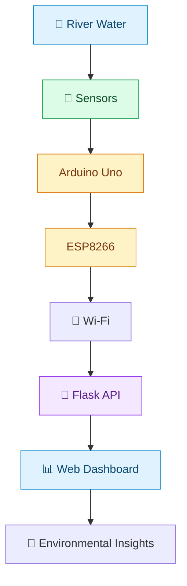
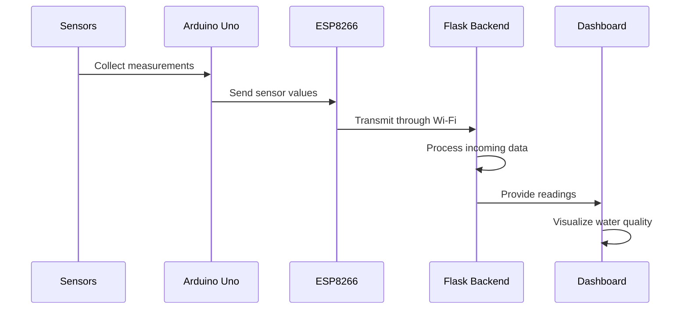
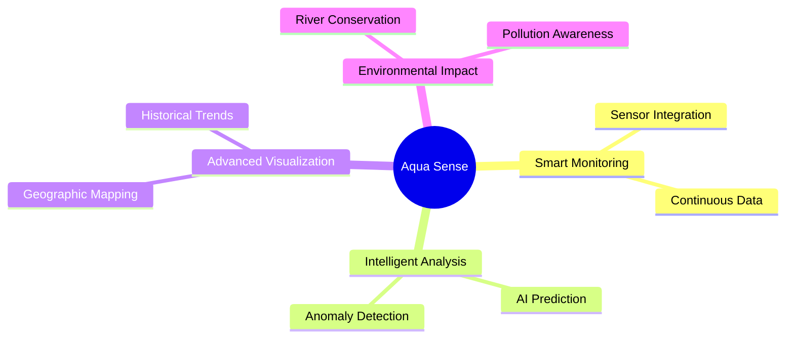

# 🌊 AQUA SENSE

### Smart River Water Quality Monitoring System

**Monitor · Analyze · Protect**

An IoT-based solution for monitoring river water quality through smart sensors and real-time data visualization.

 

---

## 🌍 Project Overview

Aqua Sense is an **IoT-based river water quality monitoring system** designed to measure important water quality parameters and visualize sensor readings through a web dashboard.

The system combines hardware sensors, wireless communication, and web technologies to support environmental monitoring and river conservation.

---

## 🔬 What We Monitor

| 🌡️ Temperature | 🌫️ Turbidity | 💧 TDS |
|:---:|:---:|:---:|
| DS18B20 | SEN0189 | TDS Sensor V1.0 |
| Water temperature | Water cloudiness | Dissolved solids estimation |

---

## ⚙️ System Architecture

### 🔄 Data Flow

**Sensors → Arduino → ESP8266 → Wi-Fi → Flask Backend → Dashboard**

---

## 🧠 Technology Stack

| Layer | Technology |
|:---:|:---|
| 🔬 Sensing | DS18B20 · SEN0189 · TDS Sensor |
| ⚡ Processing | Arduino Uno |
| 📡 Communication | ESP8266 · Wi-Fi |
| 🖥️ Backend | Python · Flask |
| 📊 Frontend | HTML · CSS · JavaScript |

---

## ✨ Key Features

| 🌡️ | 💧 | 📡 |
|:---:|:---:|:---:|
| Temperature Monitoring | TDS Measurement | Wireless Communication |

| 🌫️ | 📈 | 🌍 |
|:---:|:---:|:---:|
| Turbidity Monitoring | Data Visualization | Environmental Monitoring |

- Real-time sensor data collection
- Wireless transmission of measurements
- Web-based water quality dashboard
- Visual representation of water quality parameters
- Backend API for sensor communication
- Designed for river monitoring and environmental awareness

---

## 🔌 Hardware Components

| Component | Purpose |
|:---|:---|
| Arduino Uno | Sensor data acquisition |
| ESP8266 | Wi-Fi communication |
| DS18B20 | Temperature measurement |
| SEN0189 | Turbidity measurement |
| TDS Sensor V1.0 | TDS estimation |
| Voltage Regulator | Power regulation |

---

## 📡 Backend API

The Flask backend supports sensor communication through the following endpoints:

| Method | Endpoint | Function |
|:---:|:---:|:---|
| `GET` | `/data` | Current sensor readings |
| `GET` | `/history` | Historical measurements |
| `POST` | `/data` | Submit sensor data |

---

## 🚀 How It Works

---

## 🌱 Applications

| 🌊 | 🧪 | 🎓 |
|:---:|:---:|:---:|
| River Monitoring | Environmental Research | Educational Projects |

| 🌍 | 📊 | 💧 |
|:---:|:---:|:---:|
| Water Conservation | Data Analysis | Water Quality Awareness |

---

## 🔮 Future Scope

- 🗺️ Geographic water quality visualization
- 🤖 AI-based water quality trend analysis
- 📍 Pollution source mapping
- ☁️ Cloud-based data storage
- 🚨 Water quality anomaly alerts
- 📱 Mobile-friendly monitoring interface

---

## ⚠️ Important Note

Aqua Sense is an evolving IoT prototype for environmental monitoring.

The measured parameters alone cannot establish whether water is safe for drinking or identify specific pollutants.

Reliable interpretation requires proper calibration, validation, and laboratory testing where necessary.

---

## 🌊 Turning Water Data into Environmental Awareness

### Built with 💚 for Cleaner Rivers

**Aqua Sense**

