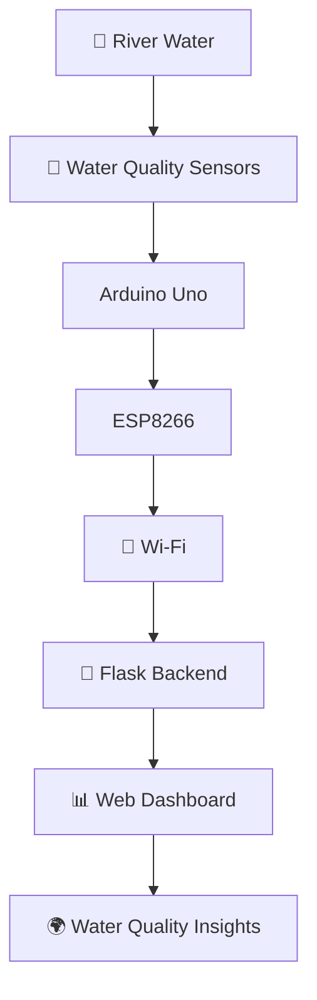

<div align="center">

# 🌊 Aqua Sense

### IoT-Based Smart River Water Quality Monitoring System

**Monitor. Visualize. Protect.**

An IoT-powered solution for monitoring river water quality through real-time sensor data and an interactive dashboard.

<br>


<br>

**Aqua Sense transforms water quality measurements into meaningful visual insights.**

</div>

---

## 📸 Project Preview

<div align="center">

<!-- Replace with your actual project screenshots -->


<br><br>


</div>

> 📌 Add your actual dashboard, hardware, and deployment images inside the `assets/` folder.

---

## 🌍 About the Project

Aqua Sense is an **IoT-based river water quality monitoring system** designed to measure important water quality parameters and visualize the collected data through a web dashboard.

The system combines sensors, microcontrollers, wireless communication, and a web-based interface to support environmental monitoring and river conservation.

### 🎯 What Aqua Sense Monitors

| Parameter | Sensor | Purpose |
|---|---|---|
| 🌡️ Temperature | DS18B20 | Water temperature |
| 🌫️ Turbidity | SEN0189 | Water cloudiness |
| 💧 TDS | TDS Sensor V1.0 | Total dissolved solids |

---

## ⚙️ How It Works

<div align="center">



</div>

### 🔄 Data Flow

**Sensors → Arduino → ESP8266 → Flask API → Dashboard**

Sensor measurements are collected by the hardware, transmitted through the ESP8266, processed by the backend, and displayed on the web interface.

---

## 🧠 System Architecture

<div align="center">

| Layer | Components |
|:---:|:---|
| 🔬 **Sensing** | DS18B20 · SEN0189 · TDS Sensor |
| ⚡ **Processing** | Arduino Uno |
| 📡 **Communication** | ESP8266 · Wi-Fi |
| 🖥️ **Backend** | Python · Flask |
| 📊 **Visualization** | HTML · CSS · JavaScript |

</div>

---

## ✨ Features

<div align="center">

| 🌡️ | 💧 | 📡 |
|:---:|:---:|:---:|
| Temperature Monitoring | TDS Measurement | Wireless Data Transfer |

| 🌫️ | 📊 | 🌍 |
|:---:|:---:|:---:|
| Turbidity Monitoring | Interactive Dashboard | Environmental Awareness |

</div>

- 📈 Visual representation of water quality parameters
- 🔄 Sensor data collection and transmission
- 🌐 Web-based monitoring interface
- 🧪 Support for water quality analysis
- 🌱 Designed for environmental monitoring applications

---

## 🛠️ Tech Stack

<div align="center">

### Hardware


### Software


</div>

---

## 🔌 Hardware Components

<div align="center">

| Component | Function |
|:---|:---|
| Arduino Uno | Sensor data acquisition |
| ESP8266 | Wireless communication |
| DS18B20 | Temperature measurement |
| SEN0189 | Turbidity measurement |
| TDS Sensor V1.0 | Dissolved solids estimation |
| Voltage Regulator | Power regulation |

</div>

---

## 💻 Software Setup

### 1️⃣ Clone the Repository

```bash
git clone YOUR_REPOSITORY_URL
```

```bash
cd aqua-sense
```

### 2️⃣ Install Dependencies

```bash
pip install flask
```

Install any additional dependencies listed in your project's `requirements.txt`.

### 3️⃣ Start the Backend

```bash
python app.py
```

> Use the actual backend entry point from your project if it differs from `app.py`.

### 4️⃣ Connect the Hardware

- Connect the sensors to the Arduino Uno.
- Connect the ESP8266 for wireless communication.
- Upload the appropriate firmware.
- Configure the Wi-Fi credentials.
- Connect the hardware to the backend.

### 5️⃣ Open the Dashboard

Launch the frontend using your project's configured development server or open the appropriate HTML page.

---

## 📡 API Endpoints

The Flask backend provides the following endpoints:

| Method | Endpoint | Description |
|:---:|:---|:---|
| `GET` | `/data` | Retrieve current sensor data |
| `GET` | `/history` | Retrieve historical readings |
| `POST` | `/data` | Submit sensor measurements |

---

## 🚧 Project Status

<div align="center">


</div>

Aqua Sense is an evolving project focused on smart water quality monitoring.

**Current development areas:**

- Hardware integration
- Sensor data collection
- Backend communication
- Dashboard visualization
- Water quality monitoring

---

## ⚠️ Important Note

Aqua Sense is a prototype intended for environmental monitoring and educational purposes.

The measured parameters alone cannot determine whether water is safe for drinking or identify specific pollutants.

Accurate interpretation requires proper sensor calibration, validation, and laboratory testing where necessary.

---

## 🔮 Future Scope

- 🗺️ Geographic water quality visualization
- 🤖 AI-based water quality trend analysis
- 📍 Pollution source mapping
- ☁️ Cloud-based data storage
- 📱 Mobile-friendly monitoring
- 🚨 Water quality anomaly alerts
- 📊 Long-term environmental data analysis

---

## 🤝 Contributions

Contributions, suggestions, and improvements are welcome!

1. Fork the repository
2. Create a new branch
3. Make your changes
4. Submit a pull request

---

<div align="center">

## 🌱 Built for Cleaner Rivers

**Aqua Sense — Turning Water Data into Environmental Awareness**

<br>

⭐ If you find this project interesting, consider giving it a star!

</div>
